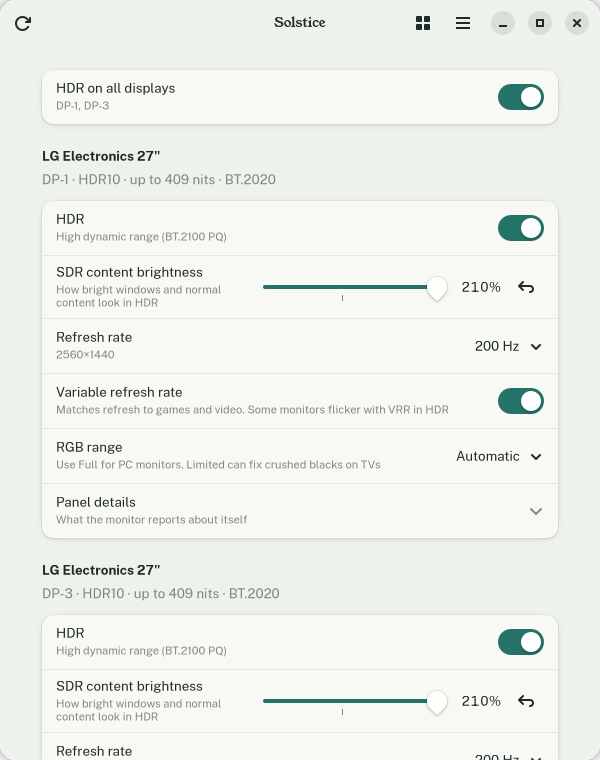
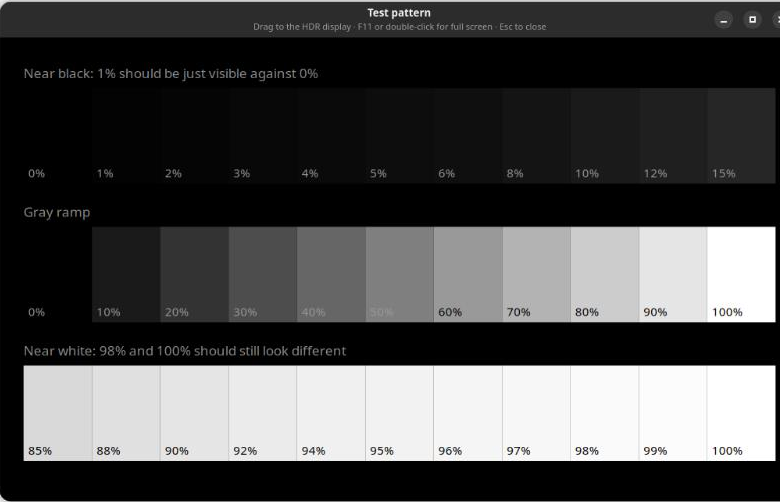

# Solstice

*Formerly Gleam. Part of the Sedge family of webhookstudios apps.*

HDR settings for Ubuntu. Turn HDR on per display, and tune how bright normal content looks while HDR is on.



## What it does

- **HDR on/off** for each display, or all at once. Only displays that support HDR over their current connection can be switched.
- **SDR content brightness** (10–210 %, default 100 %): how bright windows, the desktop and other non-HDR content look in HDR mode. GNOME resets this to 100 % every time HDR turns on and at every login. Solstice remembers your value per monitor and puts it back.
- **Wide color gamut** in SDR: uses the panel's full native colors without HDR.
- **Refresh rate**, **variable refresh rate (VRR)** and **RGB range** (Automatic / Full / Limited).
- **Panel details**: what the monitor reports in its EDID (HDR10/HLG support, peak and full-screen brightness, black level, BT.2020/DCI-P3, HDR10+ and Dolby Vision).
- **Test pattern** (grid button): near-black, gray and near-white steps for setting SDR content brightness.
- **Keep or revert**: every display change asks to be kept and reverts after 15 seconds if the screen goes black or you don't answer, the same as GNOME Settings.



## Command line and shortcuts

```
gleam status                  # HDR state, brightness and panel info for each display
gleam on [DP-1 ...]           # HDR on (all HDR displays if none given)
gleam off [DP-1 ...]
gleam toggle                  # good for a keyboard shortcut
gleam brightness 120 [DP-1]   # SDR content brightness in HDR, saved per monitor
```

Command-line changes are saved immediately, with no keep/revert prompt.

Right-click Solstice in the dock or apps grid for **Turn HDR On**, **Turn HDR Off** and **Toggle HDR**.

For a keyboard shortcut, go to Settings → Keyboard → View and Customize Shortcuts → Custom Shortcuts and add one with the command `gleam toggle`.

## Requirements

GNOME 48 or newer on Wayland (Ubuntu 25.04+). Tested on Ubuntu 26.04 with GNOME Shell 50.1 and two LG UltraGear 27" HDR400 monitors over DisplayPort.

HDR must also be enabled in the monitor's own on-screen menu on some models, and the cable/port must support it (DisplayPort 1.4 or HDMI 2.0+).

## Install

### With the deb package (recommended)

Download `gleam_1.1.0_all.deb` from the [latest release](https://github.com/webhookstudios/gleam/releases/latest), then install it:

```bash
sudo apt install ./gleam_1.1.0_all.deb
```

Open Solstice from the apps menu. The package also adds a login item that re-applies your saved HDR brightness. Remove it with `sudo apt remove gleam`.

### From source, for the current user only

```bash
git clone https://github.com/webhookstudios/gleam.git
cd gleam
./install.sh
```

This installs to `~/.local/share/gleam`, adds `gleam` to `~/.local/bin`, and adds the same login item. Remove it with `./install.sh --uninstall`.

To build the deb yourself, run `./build-deb.sh`; it writes `dist/gleam_<version>_all.deb`.

## How it works

Solstice talks to Mutter (GNOME's display server) over its `org.gnome.Mutter.DisplayConfig` D-Bus interface, the same one GNOME Settings uses:

- HDR, wide gamut, refresh rate, VRR and RGB range go through `ApplyMonitorsConfig`. Kept changes are saved to `~/.config/monitors.xml` by Mutter.
- SDR content brightness uses the software backlight Mutter offers for each display in HDR mode (`SetBacklight`).
- Saved brightness lives in `~/.config/gleam/settings.json`, keyed by monitor vendor, model and serial number, so it follows the monitor to another port.
- Panel details are read from `/sys/class/drm/*/edid`.

## Limits

- Solstice cannot change what the monitor itself does with HDR (its tone mapping, local dimming or HDR picture mode). Use the monitor's own menu for those.
- The SDR content brightness range (10–210 %) is set by Mutter.
- Apps only show real HDR content if they support Wayland HDR themselves (for example mpv, Firefox with HDR video, and games through Proton with HDR enabled).
